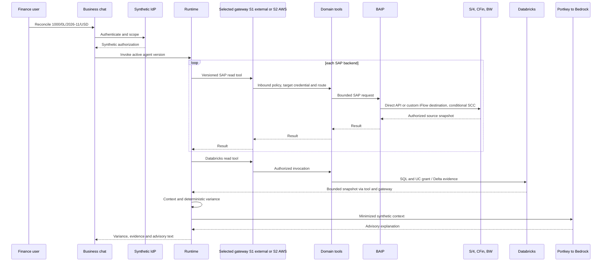

# Architecture mapping and design checkpoint

The source authority is the editable v7 deck, six-perspective v5 review, prerequisites and component verification plan in `Documents/ChatGPT/architectural Diagrams`. Their candidate identity and integration paths remain candidate. The 12-slide v7 deck has S1 and S2 L1/L2 views and G1–G7 open gates.

## Module boundaries

| Architecture role | Local simulator |
| --- | --- |
| Finance entry, synthetic IdP and role checks | `poc.app`, `poc.identity` |
| Foundry SDK, creation API and CI-style receipt | `poc.foundry`, `poc.app` |
| Runtime, Context Manager and deterministic engine | `poc.runtime` |
| S1 Apigee and S2 AgentCore Gateway | `poc.gateway`, one `GatewayPort` |
| Versioned domain tools and operation policy | `poc.tools` |
| API Management, direct API, custom iFlow, destinations and conditional SCC | `poc.baip` |
| S/4HANA, Central Finance, BW/4HANA and Databricks | `poc.backends` |
| Future BDC reference-only sharing | `poc.tools`, `poc.app` |
| Portkey policy and Bedrock response | `poc.model` |
| n8n, approver callback and executor | `poc.approval` |
| Durable cases, events, idempotency and journal ledger | `poc.store` SQLite |
| Synthetic monthly source history and journal evidence | `poc.history` SQLite seed |
| Prior local architecture presentation (retained for reference) | `static/architecture.js`, `static/architecture.css` |
| Node-built business and architect interface | `frontend/src/App.jsx`, `frontend/src/style.css`, `frontend/src/branches.css` |
| FastAPI browser transport | `poc.app`, `frontend/src/main.jsx` |
| Streamlit Community Cloud entrypoint and Python action bridge | `streamlit_app.py`, `frontend/src/streamlit.jsx` |
| Bounded question answers and case-linked follow-up traces | `poc.questions` |
| Company-neutral architecture projection | `poc.architecture_view` |
| Open-question decision evaluator and paced SQLite trace | `poc.decision_lab` |
| On-demand architecture-questions meeting interface | `frontend/src/ArchitectureQuestions.jsx`, `frontend/src/questions.css` |

The complete named component and connector definitions live in `component_registry.yaml` and `edge_registry.yaml`. The registry is generated from stable IDs in `poc.registry`; every entry has an inspectable detail drawer. The local process uses function boundaries as its transport and persists request and response events separately. Each source component also has a local component log record, correlated by case ID in the telemetry view. These are POC logs, not a shared vendor-native log service. There is no Runtime-to-SAP path: Runtime calls the selected gateway, tool, BAIP, destination, backend role and backend API in that order.

## Live architecture demo

The presentation layer now frames the scenario as **finance user → external finance agent → approved gateway → SAP-owned finance tools → SAP integration → backend authorization and source evidence → reconciliation result**. The five journey states use persisted `submit_request`, `invoke_agent`, `read_sap`, `sap_read` and `calculate_variance` events. The first three mark a submitted request; the last two require recorded responses. The SAP source cards have a distinct domain boundary. This is a projection of local events, not evidence that an external runtime or SAP tenant is connected.

Node.js builds the React interface, while Python executes the bounded simulator and SQLite persists its synthetic event trail. These physical implementation details appear in the linked Evidence view. The named AgentCore, Apigee, Integration Suite and backend nodes remain simulated architecture roles. S1 and S2 remain the live demo alternatives, and S3 remains an unapproved combined-path decision probe.

The Node-built interface has a business workspace, a dedicated company-neutral architecture view, a linked Evidence & correlation view, and an on-demand architecture-questions decision lab. The topology derives from the reviewed v7 registry: request/tool path, sequential SAP and Databricks source reads, deterministic return, plus separate design-time, AWS control, future BDC and approval branches. Each registered component is selectable and shows purpose, owner, trust boundary, contract, latest bounded message and remaining live vendor validation. The route and component state follow persisted request/response events from the selected S1 or S2 run. `POST /api/runs` returns a case ID before execution finishes; `GET /api/architecture/runs/{case_id}/stream` replays a neutralized SQLite event projection as server-sent events and then signals completion. Stored cases can be loaded and replayed. The run-speed selector adds local demonstration latency between component calls; it does not alter finance arithmetic.

The Streamlit entrypoint mounts the same compiled React interface as a Components v2 element. Typed frontend actions call the Python simulator in the viewer's session; a 0.4-second fragment refresh passes new neutralized SQLite events to the component. This does not require a separate Node server at hosting time. The FastAPI path remains available for local development and API inspection. Both paths use the same `poc.runtime`, `poc.store`, `poc.questions` and registry modules.

The bounded business intent parser recognizes reconciliation, variance and balance requests. For the demo it can infer the one documented synthetic company/ledger/currency scope, and the response says which fields were supplied. Missing period asks for follow-up. Case follow-ups answer variance, evidence, freshness, monthly journals, approval status and common architecture topics using the stored result and static simulator contracts. Each follow-up records a question-to-context-to-answer event path. Unsupported questions return an explicit evidence limit. This is a deterministic parser and answer catalog, not an unrestricted language model or document generator.

The agentic extension adds a typed `sap.compare` tool binding. For a November case, the investigation plan checks the unchanged source snapshot, routes document comparison through S1 Apigee or S2 AgentCore Gateway and the simulated SAP API Management/custom iFlow/Central Finance path, tests whether a single document explains the exact variance, then recommends either an operator-controlled synthetic reprocess or a manual mapping review. Its dossier persists each step, evidence ID, payload hash, diagnosis and after-run result. The architecture projection displays component events and neutral proof references; detailed document and correlation evidence is reached through links to the Evidence view.

## Architecture questions and candidate S3

The on-demand Architecture questions view turns six open discussion questions into synthetic runs: SAP-owned MCP hosting, two-gateway control ownership, SAP principal propagation, read versus approval-gated write, Foundry registration, and external-agent onboarding. A question click starts a Python `poc.decision_lab` evaluation. FastAPI exposes start/read endpoints; Streamlit carries the same action through the viewer's session. Each run has a random ID and paced progress persisted through `poc.store` SQLite state. The UI reveals only completed handoffs, their redacted input/output, control owner, status, synthetic evidence ID and unresolved live proof. A JSON decision packet can be downloaded; its meeting status remains OPEN.

S1 and S2 remain the v7 gateway alternatives. **S3 is a candidate question for architecture review**, not an approved extension of that deck or a live integration. It represents AgentCore Runtime → AgentCore Gateway → SAP Apigee MCP → SAP Integration Suite → conditional Cloud Connector → backend role/API. The Foundry registry appears in a separate design-time prerequisite lane, not in the runtime request path. The identity and control probes can deny a run at registration, gateway target/caller, approval or SAP backend role. Even a completed run is labelled SIMULATED; no step proves Entra exchange, Apigee interoperation, SAP principal propagation or tenant authorization.

The **Hosting & dependencies** dialog supplies a route-specific implementation contract from `poc.route_playbooks`. S1 requires SAP to expose and secure an Apigee MCP endpoint for direct agent access. S2 models a finance MCP adapter on AgentCore Runtime behind AgentCore Gateway; the MCP-server target listing mode, hosting approval and identity model remain open. A Runtime passthrough target requires a separate non-MCP Gateway and path-based client design and is outside S2. S3 requires an Apigee MCP Discovery Proxy, an externally reachable MCP URL configured as an AgentCore Gateway MCP-server target, compatible protocol and outbound OAuth, a tool listing/synchronization choice, a gateway control matrix and an end-to-end SAP identity proof. Each handoff names its configuration, prerequisite, owner and nonproduction acceptance proof. Question-specific dependencies and route decisions remain OPEN until the named teams approve them and tenant evidence exists. The public vendor links in that dialog are design references, not proof of the proposed tenant configuration.

The third visible **Architecture pros & cons** tab has four internal views: S1, S2, S3 and a dedicated comparison table. Each route has a one-screen MCP overview, while the comparison view gives a compact side-by-side judgment. A separate hosting shortlist remains visible below every MCP view. Full handoff proofs, the control matrix and hosting prerequisites open in detail dialogs. Seven company-neutral architecture diagrams are available from the three MCP routes and four agent-hosting cards. The diagrams show proposed left-to-right tool calls, the evidence return, component owners and open cross-cutting controls; they do not represent tenant connectivity. Evidence and Architecture questions are linked detail views rather than primary tabs. It separates the SAP-selected Apigee domain direction from the still-open enterprise access policy: S1 invokes Apigee directly from AgentCore Runtime; S2 models an AgentCore Runtime-hosted SAP finance MCP adapter behind AgentCore Gateway, with SAP retaining the tool and API contract; S3 registers SAP's externally reachable Apigee MCP endpoint as an AgentCore Gateway MCP-server target. The selectable handoffs show configuration, dependency, accountable team and nonproduction proof. Benefits and tradeoffs are architecture judgments for discussion, not measurements or product approval. The control matrix keeps discovery, identity, SAP authorization and decision status visible across all three routes. A local simulation does not establish cross-cloud connectivity or principal propagation.

## S1 and S2 sequences

For a write, Runtime creates an immutable proposal. n8n requests a separate finance approver decision. The trusted callback enters the Controlled Posting Executor. It rechecks the hash, case version, current S/4 balance, source freshness and idempotency, then calls the restricted posting tool through the selected gateway and BAIP. Only the S/4 simulator can create a `SYN-` document number.

## Synthetic fixture

| Source | USD balance | Snapshot (UTC) | Meaning |
| --- | ---: | --- | --- |
| S/4HANA | 1,000,000 | 2026-11-30 18:00 | Current G/L and journal fixture |
| Central Finance | 975,000 | 2026-11-30 18:05 | Comparable mapped replication |
| BW/4HANA | 975,000 | 2026-11-30 18:10 | Aggregate context, not variance operand |
| Databricks | 975,000 | 2026-11-30 18:15 | Historical evidence, not variance operand |

Deterministic calculation: `1,000,000 - 975,000 = 25,000 USD`. Any stale Central Finance, BW or Databricks source makes the result `stale` and blocks a proposal. Changes are pull based and observed on the next run.

The historical seed extends this fixture across December 2025–November 2026 in SQLite: 288 per-account source balances (`12 months × 4 sources × 6 accounts`) and 144 synthetic journal evidence records (`12 × 12`). Each period has source totals and freshness. February 2026 has zero variance, March has stale Central Finance, July has stale BW, and November retains the original $25,000 example. Journal fixtures provide inspectable monthly evidence; they do not drive the closing-balance calculation. Monthly source changes affect subsequent reads, while prior case results and events remain stored.

Agent hosting and MCP hosting are distinct decisions. The S1 simulation depicts an AgentCore Runtime-hosted agent calling Apigee directly without AgentCore Gateway. An AWS-free S1 candidate requires a separately approved agent runtime, such as SAP BTP Cloud Foundry or Kyma, and an independently approved model-access contract; Apigee hosts only the MCP endpoint. S2 models both the custom agent and finance MCP adapter on AgentCore Runtime. S3 keeps the Apigee MCP domain endpoint behind AgentCore Gateway, but Gateway itself does not host the agent. The qualitative comparison assesses simplicity, incremental cost, maintenance ownership and future flexibility; it has no tenant TCO, throughput or latency measurement.

The S2 reference design uses an MCP-protocol AgentCore Gateway and an MCP-server target for the Runtime-hosted SAP finance adapter. A Gateway Runtime target is a distinct passthrough design: AWS documents that it cannot be added to an MCP-protocol Gateway and does not aggregate or synchronize tools. It is not a toggle inside the depicted S2 route. See https://docs.aws.amazon.com/bedrock-agentcore/latest/devguide/gateway-target-http-runtime.html and https://docs.aws.amazon.com/bedrock-agentcore/latest/devguide/gateway-target-MCPservers.html.

## Hosting priority decision support

The route summaries show the agent-hosting assumption for each architecture, and the four visible hosting cards remain an unapproved decision aid. It treats the existing approved enterprise agent platform as the first validation candidate, with AgentCore leading only if the landing zone, Region, ownership, entitlement, security and SAP identity path are verified. BTP Cloud Foundry plus SAP AI Core generative AI hub is the SAP-owned pro-code alternative; Kyma requires a demonstrated container need and operating team. Microsoft Foundry is conditional on an actual enterprise standard and approved project, not the internal AI Foundry registry name. Joule Studio remains unavailable as user reported until exact tenant applicability is confirmed. A runtime/model split needs a documented reason. No option is awarded, priced or production validated by the demo. Public architecture references: https://architecture.learning.sap.com/docs/golden-path/ai-golden-path/build-and-deliver/build-ai-agents, https://docs.aws.amazon.com/bedrock-agentcore/latest/devguide/harness-vs-runtime.html, and https://learn.microsoft.com/azure/foundry/agents/concepts/hosted-agents.
